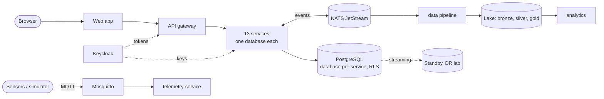

# TITAN — Total Intelligence, Technology, Automation & Network Platform

A multi-tenant operations platform for government and enterprise work, built as independently
deployable microservices: applications and approvals, infrastructure assets, IoT flood
monitoring, incident response, analytics, an optional AI assistant, and a disaster-recovery lab.

> **Status: development release, verified on one workstation with synthetic data.**
> It is not production-ready, not certified, not highly available and has never been deployed
> to a cluster. See [what was verified](docs/testing/verification-report.md) and
> [what is missing](docs/risk-register.md).

## What works today

| Area | What you can do |
| --- | --- |
| Government services | Submit an application, route it through a four-stage approval (validation, technical review, department head, final approval) with return, reject, delegation, SLA escalation, notifications and a full audit trail |
| IoT operations | Synthetic river-level, rainfall and pump sensors publish over MQTT; readings are validated and stored; a threshold breach raises an alarm, opens an incident and starts an incident-response process |
| Command center | Web application with executive dashboard, applications, review inbox, IoT operations, map, AI workspace, administration and recovery status |
| Analytics | Event stream → bronze/silver/gold lake → KPIs and trends computed from stored data |
| AI assistant (optional) | Answers questions from platform data using read-only tools with the user's own permissions; works without a model (answers are then labelled as deterministic); writes only as proposals a person approves |
| Multi-tenancy | Tenant from the verified token plus PostgreSQL row-level security; two demo tenants that cannot see each other |
| Resilience | Transactional outbox, idempotent consumers, retries, dead-letter queue, circuit breakers, bulkheads, rate limiting |
| Recovery lab | Scripted backup, restore drill, failover drill with operator confirmation, and failback, each producing a report with measured times |

13 services are implemented (10 Node.js, 3 Python) plus the gateway and web application.
7 further services of the target catalog are designed but have no code:
document, maintenance, procurement, geospatial, video, integration, report.

## Quick start

Requirements: Docker Desktop (8 GB or more assigned), Node.js 22.12 or newer. Windows
PowerShell shown; the plain `docker compose` equivalents are in the
[deployment guide](docs/deployment/deployment-guide.md).

```powershell
./scripts/titan.ps1 setup      # checks tools, creates .env from .env.example, npm install
./scripts/titan.ps1 up         # builds, starts core + iot, waits for health, loads demo data
```

Open http://localhost:3000 and sign in, for example as `alice.applicant`, `victor.validator`,
`derek.duty` or `adam.admin`. All demo users share the password in `.env`
(`DEMO_USER_PASSWORD`); they are synthetic, test-only identities.

```powershell
./scripts/titan.ps1 up -Profiles core,iot,analytics,ai,observability   # everything
./scripts/titan.ps1 status                                             # health table
./scripts/titan.ps1 down                                               # stop, keep data
```

A guided five-minute tour is in the [developer setup guide](docs/deployment/developer-setup.md).

| Address | What |
| --- | --- |
| http://localhost:3000 | Web command center |
| http://localhost:8080 | API gateway |
| http://localhost:8081 | Keycloak |
| http://localhost:3001, http://localhost:9090 | Grafana, Prometheus (`observability` profile) |

All ports are bound to 127.0.0.1.

## Tests

```powershell
npm run build                  # type-check and build all Node code
npm run test:unit:docker       # unit tests (vitest, in a container)
npm run test:integration       # integration, security and contract tests against the running stack
npm run test:e2e               # browser tests (Playwright, in a container)
npm run dr:restore-drill       # recovery drills (dr-lab profile)
npm run dr:failover-drill
npm run dr:failback
```

Integration tests need the stack running with `core,iot,analytics,ai` and seeded. Results of
the last executed runs are in the [verification report](docs/testing/verification-report.md).

## Architecture in one picture



- Each service owns its database and credentials; services share data through events, APIs or
  local projections, never through each other's tables.
- State changes and their events are written in one transaction (outbox); consumers are
  idempotent (inbox).
- The tenant always comes from the verified token; row-level security is the second layer.
- Authorization is enforced in the service that owns the data.
- AI is optional; nothing in the platform commands physical equipment.

## Documentation

Start at [docs/README.md](docs/README.md), which indexes all documents: architecture, C4
diagrams, service and database ownership, API specifications, event catalog, security, data,
AI, IoT, deployment, high availability, disaster recovery, runbooks, verification report,
decision records, risk register and roadmap.

| If you want to | Read |
| --- | --- |
| Run it and look around | [Developer setup](docs/deployment/developer-setup.md) |
| Understand the design | [System overview](docs/architecture/system-overview.md), [decision records](docs/adr/README.md) |
| Know what was actually tested | [Verification report](docs/testing/verification-report.md) |
| Know what is missing or weak | [Risk register](docs/risk-register.md), [roadmap](docs/roadmap.md) |
| Change the code | [CLAUDE.md](CLAUDE.md) (rules and conventions), [PROGRESS.md](PROGRESS.md) (current state) |

## Repository layout

```
apps/gateway, apps/web      API gateway and web command center
services/*-service          one deployable per service (NestJS or FastAPI)
packages/*                  shared infrastructure code (contracts, auth, platform, observability, pykit)
infrastructure/             docker, helm, kubernetes, opentofu, monitoring, disaster-recovery
scripts/                    titan.ps1, seed, sensor simulator, recovery drills
tests/                      integration, security, contract, e2e, performance
docs/                       documentation
```

## Things to know before using it for anything real

- All data, users, sensors and thresholds are synthetic.
- `.env.example` contains development-only credentials. Do not reuse them.
- The map page loads background tiles from the public OpenStreetMap server by default, so a
  viewer's browser contacts that third party. Set `MAP_TILE_URL` in `.env` to your own tile
  service, or to `none` to draw the map without any external request.
- The Kubernetes, Argo CD, CloudNativePG, Velero and OpenTofu files are validated against
  schemas but have never been applied to a cluster. The CI workflow has never run.
- The recovery lab runs on one machine. Its timings demonstrate the procedure, not regional
  recovery.
