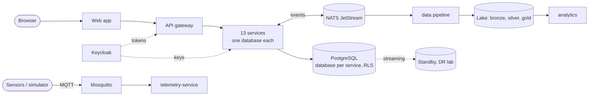

# TITAN — Total Intelligence, Technology, Automation & Network Platform

A multi-tenant, multi-industry operations platform built as independently deployable
microservices. A universal core (identity, tenancy, workflow, incidents, assets, notifications,
audit, analytics, optional AI, recovery) is extended per organisation by **industry packs**:
declarative, versioned configuration that switches on business capabilities (case management,
device telemetry, maintenance, procurement, reporting, integrations, video) and installs workflows, forms, asset categories, sensor profiles,
alarm rules and dashboards. Packs shipped: public services, disaster and infrastructure
management (flood monitoring), manufacturing, facilities management, and four cross-industry
module packs: procurement and stores, operational reporting, integration hub, video monitoring.

> **Status: development release, verified on one workstation with synthetic data.**
> It is not production-ready, not certified, not highly available and has never been deployed
> to a cluster. See [what was verified](docs/testing/verification-report.md) and
> [what is missing](docs/risk-register.md).

## What works today

| Area | What you can do |
| --- | --- |
| Government services | Submit an application, route it through a four-stage approval (validation, technical review, department head, final approval) with return, reject, delegation, SLA escalation, notifications and a full audit trail |
| IoT operations | Synthetic river-level, rainfall and pump sensors publish over MQTT; readings are validated and stored; a threshold breach raises an alarm, opens an incident and starts an incident-response process |
| Industry packs (v3) | Activate, configure, upgrade (1.0 → 1.1 with a process in flight) and deactivate packs per tenant; one tenant can run several; modules a tenant has not activated are refused by the API, not only hidden; configuration can be exported and restored |
| Manufacturing (v3) | Machine vibration and bearing-temperature telemetry → alarm → equipment incident → automatic repair request → approval → work order → completion → machine condition, incident timeline and KPIs |
| Facilities (v3) | Building service requests and inspection findings → configurable approval (budget stage from 5000) → assigned work → completion; no device needed |
| Documents and zones (core) | Controlled documents with upload check, review by a records manager through the workflow engine, classification, retention, legal hold and disposal; zones on a map, with incidents located in them through their asset or device |
| Procurement and stores | Suppliers, items, stock per store, purchase requests with approval (budget stage from 5000), purchase orders (internal records), goods receipts, stock issues and counts, automatic replenishment requests |
| Maintenance planning | Preventive plans that open work orders before they are due, inspection rounds with checklists (failures raise requests), parts booked out of stores, labour cost |
| Sourcing and budgets | Requests for quotation, quotation comparison and award, budgets per cost centre with an extra approval when exceeded |
| Digital twin | The asset hierarchy as a live schematic, with readings, alarms, incidents, work, documents, cameras and zones per asset |
| Reports, integrations, cameras | Reports from the registered datasets generated with the reader's own access (CSV, printable HTML); signed inbound webhooks that open incidents and signed outbound events to allow-listed hosts only (by default a local test receiver); a camera register with purpose-logged viewing, recording references and incident markers (no video is stored or analysed) |
| Command center | Web application whose menu and dashboards come from the tenant's packs: enterprise workspace with industry selector, shared work inbox, assets, incidents, documents, zones, cameras, procurement, reports, integrations, maintenance, production equipment, facilities, and the v2 government, IoT, map, AI, administration and recovery screens |
| Analytics | Event stream → bronze/silver/gold lake → KPIs and trends computed from stored data |
| AI assistant (optional) | Answers questions from platform data using read-only tools with the user's own permissions; works without a model (answers are then labelled as deterministic); writes only as proposals a person approves |
| Multi-tenancy | Tenant from the verified token plus PostgreSQL row-level security; two demo tenants that cannot see each other |
| Resilience | Transactional outbox, idempotent consumers, retries, dead-letter queue, circuit breakers, bulkheads, rate limiting |
| Recovery lab | Scripted backup, restore drill, failover drill with operator confirmation, and failback, each producing a report with measured times |

20 services are implemented (17 Node.js, 3 Python) plus the gateway and web application.
maintenance, document, geospatial, procurement, report, integration and video services are
minimum slices: what each does not do is listed in the [service map](docs/architecture/service-map.md)
and [ADR-0015](docs/adr/README.md).

## Quick start

Requirements: Docker Desktop (8 GB or more assigned), Node.js 22.12 or newer. Windows
PowerShell shown; the plain `docker compose` equivalents are in the
[deployment guide](docs/deployment/deployment-guide.md).

```powershell
./scripts/titan.ps1 setup      # checks tools, creates .env from .env.example, npm install
./scripts/titan.ps1 up         # builds, starts core + iot, waits for health, loads demo data
```

Open http://localhost:3000 and sign in, for example as `alice.applicant`, `victor.validator`,
`derek.duty` or `adam.admin` (government and flood monitoring), `maya.admin`, `sam.supervisor`
or `tim.technician` (manufacturing and facilities in one tenant), `rita.requester` (an occupant
raising facility requests). All demo users share the password in `.env`
(`DEMO_USER_PASSWORD`); they are synthetic, test-only identities. Upgrading a v2 installation:
also run `node scripts/identity-sync.mjs` once.

```powershell
./scripts/titan.ps1 up -Profiles core,iot,analytics,ai,observability   # everything
./scripts/titan.ps1 status                                             # health table
./scripts/titan.ps1 down                                               # stop, keep data
```

A guided five-minute tour is in the [developer setup guide](docs/deployment/developer-setup.md).

| Address | What |
| --- | --- |
| http://localhost:3000 | Web command center |
| http://localhost:8080 | API gateway |
| http://localhost:8081 | Keycloak |
| http://localhost:8025 | Mailpit: every e-mail the platform sends (nothing leaves the machine) |
| http://localhost:8888 | Local video test server (synthetic streams for the camera page) |
| http://localhost:3001, http://localhost:9090 | Grafana, Prometheus (`observability` profile) |

All ports are bound to 127.0.0.1.

## Tests

```powershell
npm run build                  # type-check and build all Node code
npm run test:unit:docker       # unit tests (vitest, in a container)
npm run test:integration       # integration, security and contract tests against the running stack
npm run test:e2e               # browser tests (Playwright, in a container)
npm run dr:restore-drill       # recovery drills (dr-lab profile)
npm run dr:failover-drill
npm run dr:failback
```

Integration tests need the stack running with `core,iot,analytics,ai` and seeded. Results of
the last executed runs are in the [verification report](docs/testing/verification-report.md).

## Architecture in one picture



- Each service owns its database and credentials; services share data through events, APIs or
  local projections, never through each other's tables.
- State changes and their events are written in one transaction (outbox); consumers are
  idempotent (inbox).
- The tenant always comes from the verified token; row-level security is the second layer.
- Authorization is enforced in the service that owns the data.
- AI is optional; nothing in the platform commands physical equipment.

## Documentation

Start at [docs/README.md](docs/README.md), which indexes all documents: architecture, C4
diagrams, service and database ownership, API specifications, event catalog, security, data,
AI, IoT, deployment, high availability, disaster recovery, runbooks, verification report,
decision records, risk register and roadmap.

| If you want to | Read |
| --- | --- |
| Run it and look around | [Developer setup](docs/deployment/developer-setup.md) |
| Understand the design | [System overview](docs/architecture/system-overview.md), [decision records](docs/adr/README.md) |
| Know what was actually tested | [Verification report](docs/testing/verification-report.md) |
| Know what is missing or weak | [Risk register](docs/risk-register.md), [roadmap](docs/roadmap.md) |
| Change the code | [CLAUDE.md](CLAUDE.md) (rules and conventions), [PROGRESS.md](PROGRESS.md) (current state) |

## Repository layout

```
apps/gateway, apps/web      API gateway and web command center
services/*-service          one deployable per service (NestJS or FastAPI)
packages/*                  shared infrastructure code (contracts, auth, platform, observability, pykit)
infrastructure/             docker, helm, kubernetes, opentofu, monitoring, disaster-recovery
scripts/                    titan.ps1, seed, sensor simulator, recovery drills
tests/                      integration, security, contract, e2e, performance
docs/                       documentation
```

## Things to know before using it for anything real

- All data, users, sensors and thresholds are synthetic.
- `.env.example` contains development-only credentials. Do not reuse them.
- The map page loads background tiles from the public OpenStreetMap server by default, so a
  viewer's browser contacts that third party. Set `MAP_TILE_URL` in `.env` to your own tile
  service, or to `none` to draw the map without any external request.
- The Kubernetes, Argo CD, CloudNativePG, Velero and OpenTofu files are validated against
  schemas but have never been applied to a cluster. The CI workflow has never run.
- The recovery lab runs on one machine. Its timings demonstrate the procedure, not regional
  recovery.
