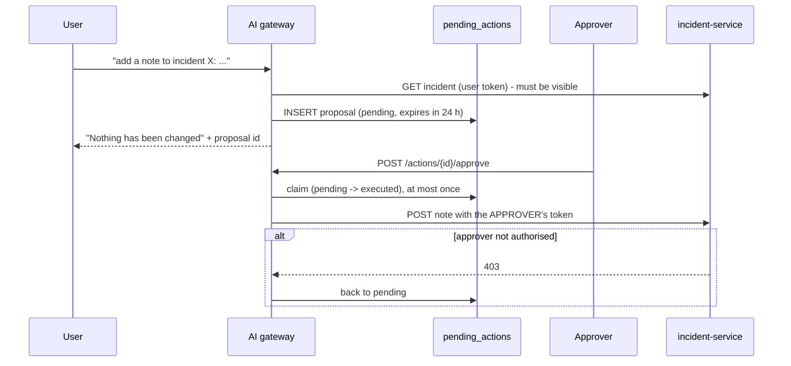

# AI architecture

Implemented in `services/ai-gateway-service`. Verified by Test E
(`tests/integration/ai-safety.test.ts`) in two modes: with no model, and with a local
`llama3.2:1b` model served by Ollama.

## Position in the platform

The AI subsystem is **optional**. Nothing in the core calls it: approvals, alarms, incidents
and analytics run with the `ai` profile stopped (tested). It is classified non-critical in the
gateway's health view.

| Mode | When | Behaviour |
| --- | --- | --- |
| `disabled` | `AI_ENABLED=false` | Endpoints answer 503 `ai_disabled` |
| `deterministic` | Enabled, no model reachable or installed | Tools still fetch records; answers are template renderings, labelled `generated_by.kind = "deterministic"` and shown in the UI as "not AI-generated" |
| `model` | Ollama reachable and the configured model installed | The model selects a tool and writes the answer, labelled with the model name; the underlying records are returned as `evidence` |

## Use cases

| Use case | Endpoint | Tool(s) |
| --- | --- | --- |
| Ask about authorised operational data | `POST /chat` | one of the read tools |
| Summarise an incident | `POST /incidents/{id}/summary` | `get_incident` |
| Explain workflow bottlenecks | `POST /workflow/bottlenecks/explain` | `workflow_bottlenecks` |
| Search approved reference documents | `POST /documents/search` | retrieval |
| Draft an operational report for review | `POST /reports/draft`, `POST /reports/{id}/review` | four read tools |
| Propose a change for human approval | `POST /chat` ("add a note to incident ...") | `propose_incident_note` |

## Tools

| Tool | Reads from | Selectable by the model |
| --- | --- | --- |
| `kpi_summary` | analytics-service | yes |
| `list_incidents`, `get_incident` | incident-service | yes |
| `workflow_bottlenecks`, `run_query_template` | analytics-service approved query templates | yes |
| `water_levels` | telemetry-service | yes |
| `search_documents` | `titan_ai` (pgvector + full text) | yes |
| `propose_incident_note` | writes only a *proposal* row | **no** — only an explicit user request reaches it |

Rules that hold for every tool:

1. **Read-only.** There is no tool that changes platform data.
2. **The user's own token.** The tool calls the owning service's public API with the caller's
   bearer token. Tenant isolation and role checks are therefore the service's, not
   re-implemented here; a 403 from the service becomes a refusal.
3. **No tenant, user or role arguments.** Identity cannot be supplied by the model (unit-tested).
4. **Schema-validated arguments** (Pydantic, `extra = forbid`).
5. **Timeouts** per call, **rate limit** per user, **one tool** per question.
6. **Audited.** Every call, refusal and approval is written to `tool_executions` (append-only) and
   announced as `ai.tool.executed.v1`, which reaches the platform audit trail.

No database administration privilege exists anywhere on this path: analytical access is through
fixed query templates on a read-only role.

## Retrieval

- Only documents approved by a tenant administrator are indexed.
- Visibility is filtered **in SQL** before text leaves the database: tenant by row-level security,
  role by `allowed_roles`.
- Lexical search (PostgreSQL full text) always works. If an embedding model is available,
  chunks are embedded (768 dimensions) and semantic matches are added (`retrieval: "hybrid"`).
- Chunks matching prompt-injection patterns are stored with `flagged = true`. They are shown to
  people with a warning and are never passed to a model.

## Prompt-injection defences

The guarantees are structural; the screening only reduces noise.

| Layer | What it does |
| --- | --- |
| No write capability | Even a fully hijacked model can only choose among read tools |
| User-scoped reads | A hijacked model can read only what the user could read anyway |
| Plan validation | The model's tool choice must be strict JSON naming an allow-listed tool with valid arguments; otherwise it is discarded and fixed rules route the question |
| Untrusted-content framing | Questions and records are wrapped in blocks with an unpredictable delimiter; the system prompt declares block content to be data |
| Screening | Flagged questions, documents or record text keep the model out of the loop for that answer (deterministic rendering, `security_flags` reported) |
| Sources built by code | Source references come from the tool result, never from model output |
| No evidence, no model | When tools return nothing, the answer is "insufficient evidence"; the model is not asked to fill the gap |

## Human approval for writes

Other requests to change data ("close incident ...", "approve ...") are refused and recorded.
Generated text can never substitute for a workflow decision: decisions exist only in
workflow-service, behind its own authorization.

## Configuration

| Variable | Default | Meaning |
| --- | --- | --- |
| `AI_ENABLED` | `true` | Feature flag |
| `OLLAMA_BASE_URL` | `http://host.docker.internal:11434` | Model server; unreachable by default, giving deterministic mode |
| `OLLAMA_CHAT_MODEL` / `OLLAMA_EMBED_MODEL` | `llama3.2:1b` / `nomic-embed-text` | Models |
| `AI_RATE_LIMIT_PER_MINUTE` | 60 | Per user |

To use a local model: `docker compose --profile ai-model up -d ollama`, pull the models, set
`OLLAMA_BASE_URL=http://ollama:11434` and recreate `ai-gateway-service`
(see the [deployment guide](../deployment/deployment-guide.md#optional-local-model)).

## Limitations

- Evaluated with one small model on CPU. Answer quality was not benchmarked; the tests assert
  safety properties and grounding in records, not linguistic quality.
- A small model's tool choice is often rejected by validation; the rule router then decides.
- One tool per question; no multi-step reasoning (LangGraph was not needed, see ADR-0008).
- Rate-limit state is per process. Embeddings exist only for documents added while an embedding
  model was available.
- Model output is not fact-checked against the records automatically; the records are shown
  beside the answer for the person to verify.
