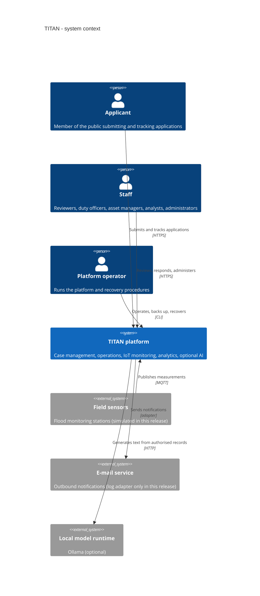
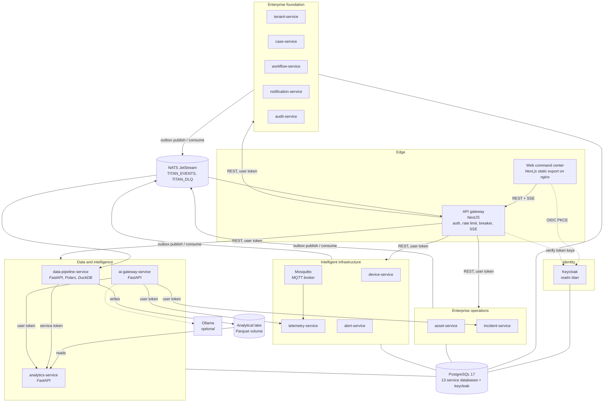
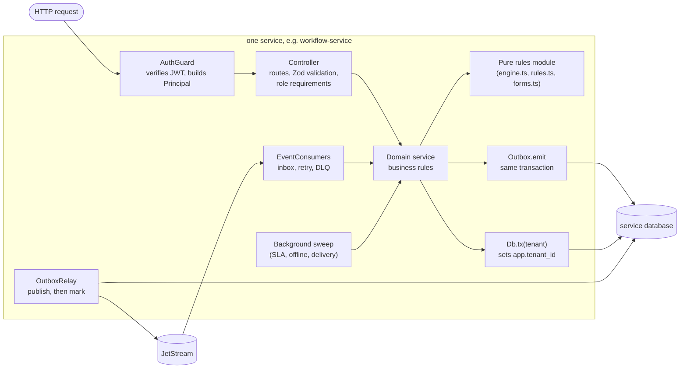
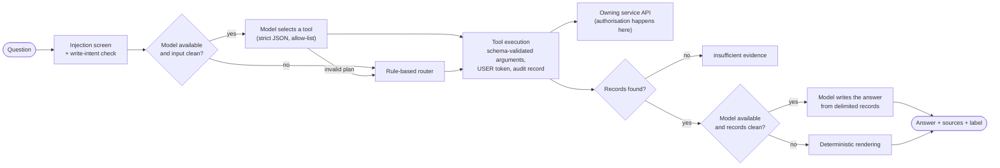
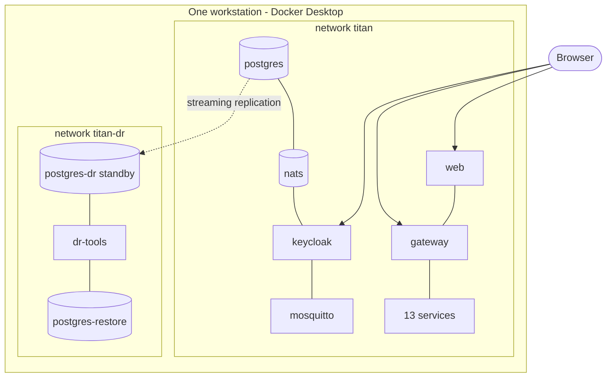
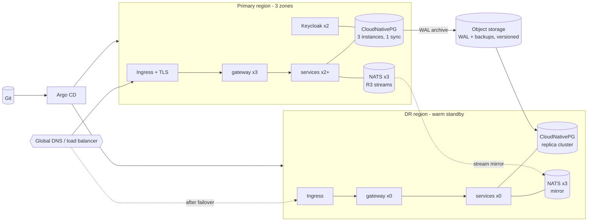

# C4 architecture diagrams

Diagrams describe the implemented system unless a box is marked *planned*.

## Level 1 — system context

## Level 2 — containers

## Level 3 — components of a Node service

Every NestJS service has the same internal structure; only the domain differs.

Shared code (`packages/platform`, `authentication`, `observability`, `contracts`) provides the
grey plumbing only: guard, transaction helper, outbox, relay, consumers, health, metrics.

## Level 3 — components of the AI gateway

## Deployment — local development (implemented)

## Deployment — production target (planned, not deployed)

Details: [high availability](high-availability.md) and
[disaster recovery](../disaster-recovery/dr-architecture.md).
