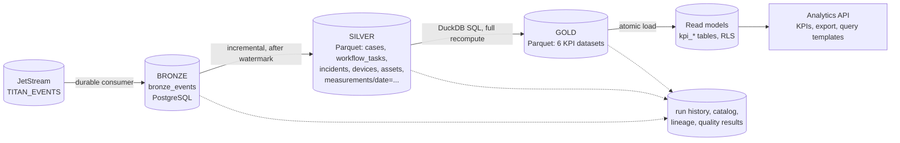

# Data engineering architecture

Implemented in `services/data-pipeline-service` (pipeline) and `services/analytics-service`
(serving). Verified by `tests/integration/analytics.test.ts` and the pipeline unit tests.

## Layers

| Layer | Content | Storage | Properties |
| --- | --- | --- | --- |
| Bronze | Every business event exactly as received, with source metadata (`source`, `stream_seq`, `ingested_at`) | `titan_pipeline.bronze_events` | Append-only; unique on `event_id` so redelivery lands once |
| Silver | One row per business entity (latest state), and accepted measurements | Parquet in the lake | Validated, standardised (UTC timestamps without zone), deduplicated |
| Gold | Aggregates ready for reporting | Parquet in the lake, then PostgreSQL read models | Recomputed from silver on every run |

The pipeline never reads another service's database: its only input is the event stream.

## A run

1. Insert a `pipeline_runs` row (`running`) with the current watermark.
2. **Incremental read:** bronze rows with `seq > watermark` (at most 250 000 per run).
3. **Silver:** map events to partial rows, merge with the existing dataset using "latest non-null
   value per key in bronze order", apply quality rules, write atomically (temporary file, rename).
   Measurements are appended to per-day files and deduplicated on their natural key.
4. **Gold:** DuckDB SQL over the silver files (see `app/gold.py`), written atomically.
5. **Commit** in one database transaction: new watermark, run `succeeded`, catalog, lineage and
   quality results.
6. Ask analytics-service to load the new gold files (service token) and publish
   `pipeline.run.completed.v1`. analytics-service also polls for new files, so a missed request
   only delays the refresh.

Runs are scheduled (`PIPELINE_INTERVAL_SECONDS`, default 30 s in compose, whenever events are
waiting or gold is more than 5 minutes old) and can be triggered on demand (`POST /runs`).

### Idempotency and failure

- The merge is idempotent: applying the same events twice gives the same silver.
- The watermark moves only in the transaction that marks the run succeeded. A run that fails
  after writing silver leaves the watermark alone; the next run or `POST /runs/{id}/retry`
  reprocesses the same events with no double counting.
- Failures are recorded (`status = failed`, `error`); retries carry `retry_of` and `attempt`.
- A failure can be injected in development (`{"simulate_failure": true}`) to exercise this path.

## Data quality rules

Rows failing a rule are left out of silver and counted in `quality_results` (per run, per rule).

| Dataset | Rules |
| --- | --- |
| all | tenant present; key present; primary key unique |
| cases | outcome in domain; completed not before submitted |
| workflow_tasks | status in domain; closed not before assigned |
| incidents | severity in domain; acknowledged not before created |
| devices | reporting interval positive |
| assets | status in domain |
| measurements | value finite; quality flag in domain; timestamp present and not far in the future |
| bronze | every event maps to its schema (malformed events are counted, not fatal) |

## KPIs (gold)

| Dataset | Calculation | Inputs |
| --- | --- | --- |
| `approval_turnaround` | Count, mean, median, 90th percentile of `completed_at - submitted_at` per form and outcome (approved or rejected) | cases |
| `pending_tasks` | Pending tasks per stage and role; overdue (`due_at` before run time); oldest age | workflow_tasks |
| `incidents_by_severity` | Incidents per severity and status; mean time to acknowledge | incidents |
| `sensor_availability` | Distinct messages in the trailing hour against the expected rate (`3600 / expected_interval`), capped at 100% | devices, measurements |
| `water_level_trend` | Mean, min, max and sample count per device in 5-minute buckets over 24 hours, quality `ok` only | measurements |
| `asset_maintenance_status` | Assets per status and condition; overdue and due-within-30-days maintenance | assets |

Every figure is computed from stored events. The integration tests change the data and check
that the KPI moves by exactly that amount, and cross-check two KPIs against the owning services.

## Metadata

| Table | Purpose |
| --- | --- |
| `pipeline_runs` | Execution history: trigger, attempt, watermark range, rows read and written, error |
| `dataset_catalog` | Layer, **owner** (producing service), steward, description, location, key, row count |
| `lineage_edges` | For each run: target dataset, source dataset, transformation |
| `quality_results` | For each run: dataset, rule, passed, failed rows, total rows |

`GET /api/pipeline/lineage?dataset=gold.sensor_availability` answers "what is this built from".

## Serving

- Read models have row-level security and are **read-only** for the service role; the only write
  path is `analytics_load()`, which replaces one dataset atomically.
- Each response carries `freshness` (`computed_at`, `source_run_id`).
- Export: `GET /api/analytics/export/{dataset}?format=csv|parquet`, the caller's tenant only.
- Approved query templates (`app/templates.py`): fixed SQL, validated parameters, a read-only
  database role with a statement timeout. This is the only analytical access the AI has.

## Rebuilding after a disaster

Derived data is reconstructable, in this order:

| Lost | Rebuild from | How |
| --- | --- | --- |
| Read models (`kpi_*`) | Gold files | `POST /internal/refresh` or wait for the poll |
| Gold | Silver | Run the pipeline (gold is always fully recomputed) |
| Silver | Bronze | Reset the watermark to 0 and run the pipeline |
| Bronze | Event stream | Delete the consumer `data-pipeline-service`; it re-lands everything still in the stream (7 days in the lab) |
| Bronze older than the stream | Database backup of `titan_pipeline`, or (not implemented) a re-export from the operational services | — |

The first three rows were exercised indirectly by the idempotency and retry tests. A full
rebuild from an empty lake has **not** been run as a drill. The lake itself is not included in
the database backup (see the [DR architecture](../disaster-recovery/dr-architecture.md)).

## Limitations

- One pipeline replica (in-process run lock). Silver entity files are rewritten whole on each run:
  fine for this scale, not for large volumes (roadmap: partitioned table format).
- "Latest non-null" merging cannot represent a field being cleared.
- The lake is a shared volume; production should use object storage with versioning.
- Pipeline metadata and bronze are platform-wide; the pipeline API exposes metadata only and is
  limited to analysts, auditors and administrators.
