# High availability design

**Read this first.** The local stack is many containers on one machine. That is not high
availability: one host, one disk, one power supply. Nothing here claims that TITAN has been
operated in a highly available configuration. This document describes (a) the properties of the
software that make HA possible, which *are* implemented and tested, and (b) the production
topology, which is **planned**: its manifests render and pass schema validation but have never
been deployed.

## What is implemented in the software

| Property | Implementation | Evidence |
| --- | --- | --- |
| Stateless services | All state is in PostgreSQL, JetStream or the lake; any replica can serve any request | Services are recreated freely in the drills |
| Liveness and readiness | `/health/live` (process), `/health/ready` (database required; broker reported) | Compose health checks; Helm probes |
| Graceful shutdown | Shutdown hooks drain NATS, stop relays and consumers, close pools | Container restarts in tests |
| Safe concurrent replicas | Outbox relay uses `FOR UPDATE SKIP LOCKED`; durable consumers are shared by replicas; delivery worker uses `SKIP LOCKED`; migrations take an advisory lock | Code; not load-tested with multiple replicas |
| Idempotency | Inbox, unique constraints, idempotency keys | Tests D, security suite, failover drill |
| Failure isolation | Per-service timeout, circuit breaker and bulkhead at the gateway; enlarged DNS lookup pool | Test G, performance smoke |
| Broker outage tolerance | Writes commit and buffer in the outbox while NATS is down | Test D |
| Dependency outage tolerance | Non-critical services can be down without affecting critical flows | Test G |
| Automatic restart | `restart: unless-stopped`; the stack came back by itself after a host reboot during development | Observed |

Known exceptions (single replica by design today):

| Workload | Why | Path to HA |
| --- | --- | --- |
| telemetry-service | One persistent MQTT session per service | MQTT shared subscriptions, one session per replica |
| data-pipeline-service | In-process run lock; one writer to the lake | Leader election or a job scheduler; table format with concurrent writers |
| Gateway rate limiter and AI limiter | In-memory state | Shared store, or limit at the ingress |
| Gateway live stream (SSE) | Each replica fans out independently (works, but clients reconnect on rollout) | Acceptable; clients auto-reconnect |

## Production topology (planned)

```mermaid
flowchart TB
  subgraph region[Primary region]
    subgraph z1[Zone A]
      g1[gateway] --- s1[services]
      p1[(PG primary)]
      n1[(NATS 1)]
    end
    subgraph z2[Zone B]
      g2[gateway] --- s2[services]
      p2[(PG sync standby)]
      n2[(NATS 2)]
    end
    subgraph z3[Zone C]
      g3[gateway] --- s3[services]
      p3[(PG standby)]
      n3[(NATS 3)]
    end
    lb[Ingress controller + TLS]
  end
  lb --> g1 & g2 & g3
  p1 -. sync .-> p2
  p1 -. async .-> p3
  n1 --- n2 --- n3
```

| Component | Design | Artefact |
| --- | --- | --- |
| Services | 2+ replicas (gateway 3+, autoscaled); rolling update with `maxUnavailable: 0`; PodDisruptionBudgets; topology spread over zones and nodes with anti-affinity; requests and limits; non-root, read-only root filesystem; dedicated ServiceAccounts without API tokens | `infrastructure/helm/titan` |
| Network | Default-deny NetworkPolicies; each service reachable only from the gateway and its declared callers; egress only to its own dependencies | Helm `networkpolicy.yaml` |
| Ingress and TLS | Ingress with TLS for web and API hosts; certificates from cert-manager | Helm `edge-and-storage.yaml` |
| Secrets | Read from Kubernetes Secrets synchronised by External Secrets Operator; nothing in Git or values | Helm `externalSecrets` |
| PostgreSQL | CloudNativePG, 3 instances over 3 zones, one synchronous standby, automatic in-region failover, continuous WAL archive and base backups | `infrastructure/kubernetes/platform/postgres-cluster.yaml` |
| NATS JetStream | 3 servers, streams with 3 replicas (Raft quorum 2): survives one server or zone | `nats-values.yaml`; `NATS_STREAM_REPLICAS=3` |
| Keycloak | 2 instances with clustered cache, database in the CloudNativePG cluster | `keycloak.yaml` |
| Migrations | Init container with the owner credentials; the service runs with the runtime role only | Helm `workloads.yaml` |
| Delivery | Argo CD ApplicationSet per region from Git | `infrastructure/kubernetes/argocd` |
| Platform install | OpenTofu module for operators, broker, secrets, backup and GitOps controllers | `infrastructure/opentofu` |
| Monitoring | Prometheus scrape annotations / ServiceMonitor, alert rules | Helm; `infrastructure/monitoring` |

### Validation performed

| Check | Result |
| --- | --- |
| `helm lint` | 0 failures |
| `helm template` + `kubeconform -strict` (Kubernetes 1.31) | 80 resources valid (82 with ExternalSecrets and ServiceMonitor enabled) |
| Platform, DR and Argo CD manifests against published CRD schemas | 12 resources valid |
| `tofu fmt -check`, `tofu validate` | valid |

### Validation NOT performed

- No deployment to any Kubernetes cluster (no cluster or local Kubernetes tool is installed on
  the development machine). The chart may need adjustment on first real use.
- No multi-replica load test, no zone-failure test, no rolling-update test.
- No measurement of availability. No availability figure is claimed.

## Failure modes and expected behaviour (design)

| Failure | Expected behaviour | Tested? |
| --- | --- | --- |
| One service replica dies | Other replicas serve; Kubernetes replaces it | Not tested (needs a cluster) |
| A whole non-critical service is down | Critical flows continue; its work resumes on return | **Yes**, Test G (compose) |
| Event broker down | Writes continue, events buffer, effects resume | **Yes**, Test D (compose, single broker) |
| One NATS server of three down | Quorum holds; no interruption | Not tested |
| PostgreSQL primary down, in region | CloudNativePG promotes the synchronous standby; services reconnect | Not tested with CloudNativePG. Manual promotion of a streaming standby was drilled |
| Whole region down | Operator-confirmed failover to the DR region | Procedure drilled on one host; see the DR documents |

## Capacity guidance

No capacity test has been run. The resource requests in the chart are starting values taken
from memory use observed in the lab (Node services 60-120 MB, Python services 100-250 MB), not
sizing recommendations.
