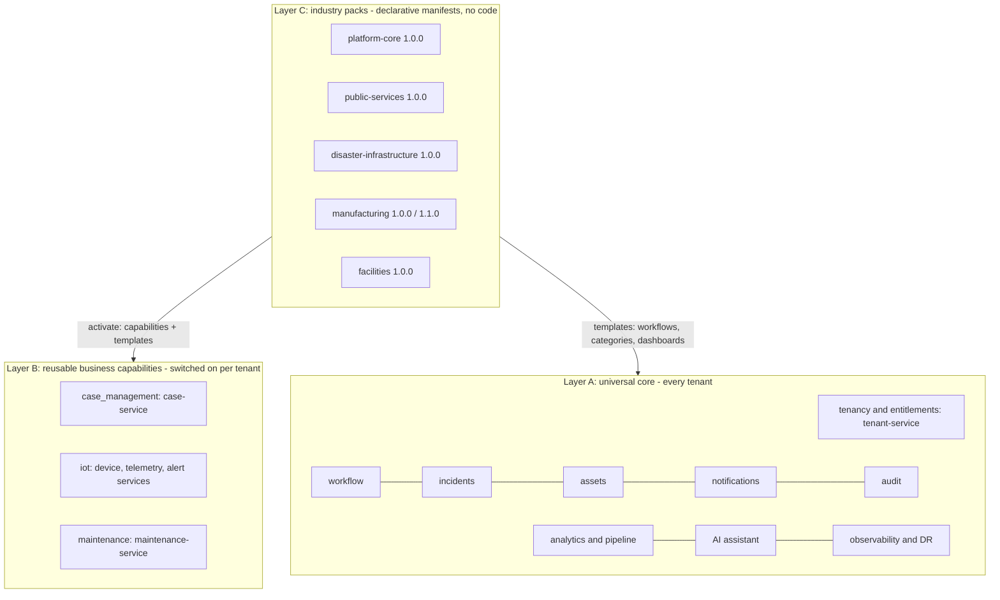
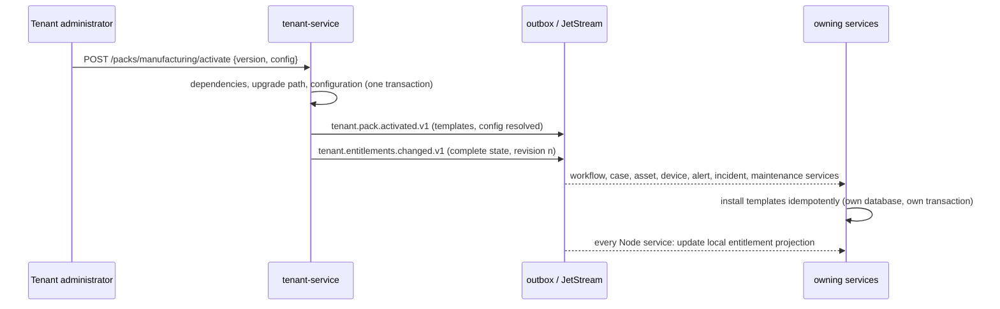

# Industry packs and the three platform layers (TITAN v3)

TITAN v3 turns the v2 government and flood-monitoring platform into an industry-agnostic one
without copying services per industry. This document describes the design as implemented, and
states plainly what is not.

## Three layers

| Layer | What | Where |
| --- | --- | --- |
| A. Universal core | Identity and tenancy, sites, entitlements, workflow, incidents, assets, notifications, audit, analytics, AI, observability, recovery | Every tenant; cannot be switched off |
| B. Business capabilities | `case_management`, `iot`, `maintenance` | Switched on per tenant by packs; enforced by the owning service |
| C. Industry packs | Versioned JSON manifests in `services/tenant-service/packs/<id>/<version>.json` | Activated, configured, upgraded and deactivated per tenant |

Capabilities and their owning services are listed in `packages/contracts/src/capabilities.ts`.
Inspection, procurement and reporting from the directive's layer B are **not implemented**:
inspection findings are a request type of the facilities pack; `inspection`, `purchase_request`,
`work_order`, `quality_deviation` and `contract` are registered workflow subject types with no
owning service yet.

## What a pack contains

A manifest (`PackManifest` in `packages/contracts/src/packs.ts`) is data only. It names
capabilities and carries templates; it never contains code, SQL or expressions. Anything it
refers to by name (datasets, query templates, AI tools, icons) must already exist in the
platform, which the manifest contract test checks.

| Section | Installed by | Notes |
| --- | --- | --- |
| `requires.capabilities`, `requires.packs` | tenant-service | Only switchable capabilities; dependencies with optional minimum version |
| `roles` | (descriptive) | Role templates shown to administrators; roles themselves live in Keycloak |
| `navigation`, `dashboards` | tenant-service `/workspace` | Filtered by role on the server; visibility only, never a control |
| `workflows` | workflow-service | Validated against the engine schema; new content becomes a new definition version |
| `forms` | case-service | New content becomes a new form version |
| `asset_categories` (+ versioned attribute schemas) | asset-service | A stored schema version is immutable |
| `sensor_profiles` | device-service | Device type, reporting interval, metric kinds, units, plausible ranges |
| `alert_rules` | alert-service | Thresholds may refer to tenant configuration (`{"$config": "..."}`) |
| `incident_categories` | incident-service | Response workflow, notified role, response targets per severity |
| `request_types` | maintenance-service | Approval workflow, requester roles, detail fields, automatic creation from incidents |
| `query_templates`, `ai_tools` | analytics-service, ai-gateway-service | Names of reviewed templates and tools the pack makes available |
| `config_schema`, `config_defaults` | tenant-service | Tenant settings, validated on every change |
| `lifecycle.upgrades_from` | tenant-service | The only versions an in-place upgrade may start from |

## Activation flow

- **Idempotent installation.** Each owner compares the template with what it holds. Unchanged:
  nothing happens. Changed workflow definitions and forms become a new version; running
  processes keep the version they started with. Rules, profiles and categories a person created
  are never changed by a pack.
- **Entitlements are a projection.** Every Node service keeps `tenant_entitlements` (platform
  migration `0001_entitlements.sql`), fed by `tenant.entitlements.changed.v1`. The revision only
  grows, so a stale delivery is ignored. `@RequireCapability(...)` plus the global
  `CapabilityGuard` refuses the API to a tenant without the capability (`403 capability_disabled`,
  recorded as `security.access_denied.v1`). A tenant the service has never heard of has no
  capability: the check fails closed.
- **Python services** (analytics, AI) ask `GET /api/tenant/entitlements` with the caller's own
  token, cache the answer for 5 seconds, keep using the last answer for up to 10 minutes if
  tenant-service is unreachable, and otherwise fail closed.
- **Upgrade of an existing installation.** Migration `0002_industry_packs.sql` gives every tenant
  that existed before v3 the platform core, `public-services` and `disaster-infrastructure`
  (exactly what v2 offered them), and tenant-service announces them on its next start.

## Deactivation, upgrade and configuration

| Operation | Effect |
| --- | --- |
| Deactivate | Status `disabled`; capabilities recomputed (a capability another active pack provides stays); `tenant.pack.deactivated.v1`. **Nothing is deleted**: records, definitions, categories and devices remain and come back on reactivation |
| Upgrade | Only along `lifecycle.upgrades_from`; downgrade needs `allow_downgrade`. Demonstrated by manufacturing 1.0.0 → 1.1.0 (new conditional approval stage, CNC attribute schema v2, new asset category) |
| Configure | Validated against `config_schema`; templates that use the settings are re-installed (for example alarm thresholds) |
| Resync | Re-announces templates and entitlements, for a service whose state was lost |
| Export / import | `titan-pack-configuration/1` document of packs, versions, settings and dashboard layouts. Import is always applied to the caller's own tenant; `dry_run` previews it |

## The generalised core

| Service | v2 | v3 |
| --- | --- | --- |
| workflow | Subject types `case`, `incident` (CHECK constraint) | Registry table `workflow_subject_types` (foreign key), generic `workflow.start.requested.v1` / `workflow.cancel.requested.v1`; return only for subject types that support it |
| incident | Origins `alert`, `manual`; one response workflow | Origins add `inspection`, `work_order`, `service_request`, `external`; categories with their own workflow, notified role and response targets; asset and site references |
| asset | Free JSON attributes | Versioned attribute schemas per category, validated on create and edit; site reference; maintenance outcome applied from events |
| device | Sensors given per device | Sensor profiles; `metric-types`; any metric kind and unit |
| analytics | Six fixed KPI endpoints | Plus a dataset registry (11 datasets) with capability per dataset, read by dashboard widgets through `POST /datasets/{name}/query` with declared filters only. The v2 endpoints are unchanged |
| AI | Fixed tool list | Core tools for everyone; industry tools (`water_levels`, `equipment_readings`, `maintenance_backlog`) only where an active pack registers them. The model is only told about available tools; execution checks again |

## Organisation structure

`sites` (tenant-service) hold business units, plants, facilities, campuses, buildings, lines and
areas in a hierarchy. Assets and incidents can refer to a site. Sites are not yet used to scope
permissions: every role applies to the whole tenant.

## Demonstrations

| Pack | Flow | Verified by |
| --- | --- | --- |
| disaster-infrastructure | The v2 flood flow unchanged (Test B) | `tests/integration/iot-incident.test.ts` |
| public-services | The v2 government flow unchanged (Test A) | `tests/integration/government-approval.test.ts` |
| manufacturing | Machine → vibration and temperature telemetry → alarm → equipment incident → automatic repair request → supervisor and planning approval → work order → completion → machine condition and incident timeline → KPI datasets | `tests/integration/manufacturing.test.ts` |
| facilities | Building → service request or inspection finding → configurable approval (budget stage from 5000) → assigned work → completion → asset back in service, requester notified. No device involved | `tests/integration/facilities.test.ts` |

Tenants: Riverbend and Northfield (public services + flood), Meridian Industrial Group
(manufacturing + facilities in one tenant), Harbourline Properties (facilities; used for the
lifecycle tests). All synthetic.

## Not implemented

- Uploading or authoring packs: the catalogue is the manifests shipped with tenant-service.
- Per-site permissions, and roles created by a pack in Keycloak (packs describe roles only).
- Inventory, procurement, inspection scheduling and report services.
- Removing what a deactivated pack installed (deliberately: nothing is deleted).
- Pack dependencies other than on `platform-core` are supported by the code but not used.
