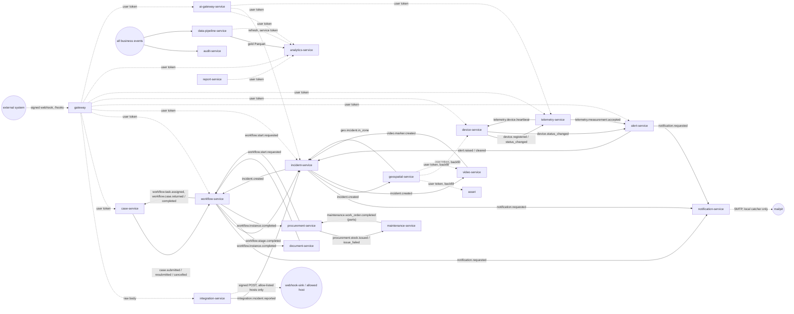

# Service map

## Responsibility matrix

Status: **Implemented** = code, migrations, API, authorization and tests exist and were run.
**Not started** = service boundary defined, no code. No service is partially implemented behind
placeholder responses.

Since TITAN v3 the incident, device, telemetry and alert services also consume
`tenant.pack.activated.v1` (pack templates), and every Node service consumes
`tenant.entitlements.changed.v1` into its own entitlement projection. Capability per service:
`case_management` (case-service), `iot` (device, telemetry, alert), `maintenance`
(maintenance-service), `procurement`, `reporting`, `integrations`, `video` (the services of
the same names); documents and geospatial are universal core (no capability). See
[industry packs](industry-packs.md) and [ADR-0015](../adr/README.md).

| # | Service | Responsibility | Status | Runtime | Database | Publishes | Consumes |
| --- | --- | --- | --- | --- | --- | --- | --- |
| 1 | tenant-service | Organisations, sites, departments, jurisdictions, memberships; **industry-pack registry, activation, entitlements, workspace navigation and dashboards** | Implemented | NestJS | `titan_tenant` | `tenant.*` incl. `tenant.pack.*`, `tenant.entitlements.changed` | — |
| 2 | case-service | Forms, case records, submissions, lifecycle, attachments, applicant tracking | Implemented | NestJS | `titan_case` | `case.*` | `workflow.task.assigned`, `workflow.case.*` |
| 3 | workflow-service | Versioned processes, tasks, decisions, delegations, SLAs, escalation | Implemented | NestJS | `titan_workflow` | `workflow.*`, `notification.requested` | `case.*`, `incident.created`, `workflow.start/cancel.requested`, `tenant.pack.activated` |
| 4 | document-service | Controlled documents: versions (max 5 MB), upload check (type signatures, EICAR; optional ClamAV, fail closed), full-text search over published text, review through the workflow engine, classification (public / internal / restricted roles), retention classes, legal hold, disposal, links to records | Implemented (after v3) | NestJS | `titan_document` | `document.*`, `workflow.start.requested` | `workflow.instance.completed` |
| 5 | notification-service | In-app notifications, e-mail over SMTP to a **local catcher (Mailpit) only**, delivery status, retry | Implemented (no real mail relay) | NestJS | `titan_notification` | `notification.delivered/failed` | `notification.requested` |
| 6 | audit-service | Append-only business and security records | Implemented | NestJS | `titan_audit` | — | all except telemetry |
| 7 | asset-service | Assets, categories with versioned attribute schemas, hierarchy, sites, lifecycle, maintenance state | Implemented | NestJS | `titan_asset` | `asset.*` | `tenant.pack.activated`, `maintenance.work_order.started/completed/cancelled` |
| 8 | maintenance-service | Request types, requests, approval outcome, work orders; **preventive plans** (work orders opened ahead of the due date, no approval: the plan is the authorisation), **inspection plans and rounds** (checklists; each failed item raises a finding request), **parts used** (booked out by procurement) and **labour cost** at the tenant rate | Implemented | NestJS | `titan_maintenance` | `maintenance.*` incl. `maintenance.inspection.completed`, `workflow.start/cancel.requested`, `notification.requested` | `tenant.pack.activated`, `incident.created`, `workflow.instance.completed`, `asset.created/status_changed`, `procurement.stock.issued/issue_failed` |
| 9 | procurement-service | Suppliers, items, stock per store, purchase requests (approval; budget stage from 5000; over-budget stage), purchase orders as internal records, goods receipts, stock issues and counts, replenishment; **requests for quotation, quotations and award**; **cost centres and budgets**; books out **parts used on work orders** | Implemented (after v3) | NestJS | `titan_procurement` | `procurement.*` incl. `rfq.awarded`, `stock.issue_failed`, `workflow.start/cancel.requested`, `notification.requested` | `workflow.instance.completed`, `maintenance.work_order.completed` |
| 10 | incident-service | Incident lifecycle, severity, assignment, timeline | Implemented | NestJS | `titan_incident` | `incident.*`, `notification.requested` | `alert.*`, `workflow.task.assigned`, `workflow.stage.completed` |
| 11 | device-service | Device registry, sensors, status, configuration, offline detection | Implemented | NestJS | `titan_device` | `device.*` | `telemetry.device.heartbeat` |
| 12 | telemetry-service | MQTT ingestion, validation, time series | Implemented | NestJS | `titan_telemetry` | `telemetry.*` | `device.registered`, `device.status_changed` |
| 13 | alert-service | Threshold rules, alarms, deduplication, escalation, acknowledgment | Implemented | NestJS | `titan_alert` | `alert.*`, `notification.requested` | `telemetry.measurement.accepted`, `device.*` |
| 14 | geospatial-service | Zones (GeoJSON polygons, computed in application code; no PostGIS), point and radius queries, map layers, incidents located through their asset or device, watched zones, backfill from the registers (caller's token) | Implemented (after v3). Not a digital twin | NestJS | `titan_geo` | `geo.*`, `notification.requested` | `asset.created`, `device.registered/status_changed`, `video.camera.registered`, `incident.created` |
| 15 | video-service | Camera register, audited viewing sessions (purpose required), recording references with retention and legal hold, incident markers. **Metadata only**: no video is stored, relayed or analysed; the browser plays HLS directly (locally from a synthetic test server) | Implemented (after v3) | NestJS | `titan_video` | `video.*`, `notification.requested` | `incident.created` |
| 16 | integration-service | Signed inbound webhooks (HMAC-SHA256, 5-minute window, event-id replay protection) that report incidents; outbound event subscriptions delivered signed, with retries and a log, to allow-listed hosts only (default: the local `webhook-sink`). No open-data adapters | Implemented (after v3) | NestJS | `titan_integration` | `integration.*`, `notification.requested` | the subscribable events (see the service) |
| 17 | data-pipeline-service | Ingestion, bronze/silver/gold, quality, lineage | Implemented | FastAPI | `titan_pipeline` + lake | `pipeline.run.completed` | business events (bronze) |
| 18 | analytics-service | KPI read models, analytical API, export, query templates | Implemented | FastAPI | `titan_analytics` | — | gold datasets |
| 19 | ai-gateway-service | Model access, retrieval, tools, proposals, drafts | Implemented | FastAPI | `titan_ai` | `ai.tool.executed` | — |
| 20 | report-service | Report definitions over the registered analytics datasets, generated on request **with the caller's token** (CSV, printable HTML, PDF, Excel), run history, due-date reminders | Implemented (after v3) | NestJS | `titan_report` | `report.generated`, `notification.requested` | — (calls analytics-service) |
| — | gateway | Edge authentication, rate limiting, routing, live stream, aggregated health | Implemented | NestJS | none | — | event stream (fan-out to browsers) |
| — | web | Command center | Implemented | static site | none | — | — |

## Dependency map

Solid arrows are asynchronous events (the publisher does not know or wait for the consumer).
Dashed arrows are synchronous HTTP calls.

### What depends on what at run time

| If this is down | Still works | Stops or is delayed |
| --- | --- | --- |
| notification-service | Approvals, incidents, alarms | Notifications are delivered after it returns (verified, Test G) |
| audit-service | Everything else | Audit records are written after it returns; none are lost (verified, Test G) |
| analytics / pipeline | All operational screens | KPI cards show "service unavailable" |
| ai-gateway / model | Everything else | AI workspace unavailable, or deterministic answers |
| analytics-service | Report definitions can be read | Report generation answers 503; a failed run is recorded |
| integration-service | Everything else; incidents can still be reported in TITAN | Inbound webhooks answer 503 at the gateway (senders retry); outbound deliveries wait in the queue |
| document / geospatial / procurement / report / video | Everything else | Only their own pages and APIs; their event consumers catch up on return |
| incident-service | Alarms are still raised | Incidents are created when it returns (verified, Test D) |
| workflow-service | Case drafting, telemetry, alarms | Submitted cases wait; incidents cannot be acknowledged (acknowledgment is a workflow step) |
| NATS | All reads and writes (events buffer in each outbox) | Cross-service effects resume when it returns (verified, Test D) |
| Keycloak | Requests with a still-valid token (keys are cached) | New sign-ins |
| PostgreSQL | Nothing that needs data | Everything; see the DR runbooks |

There is no chain of synchronous calls between business services on a write path: a write
commits in one service and reaches the others as events.
