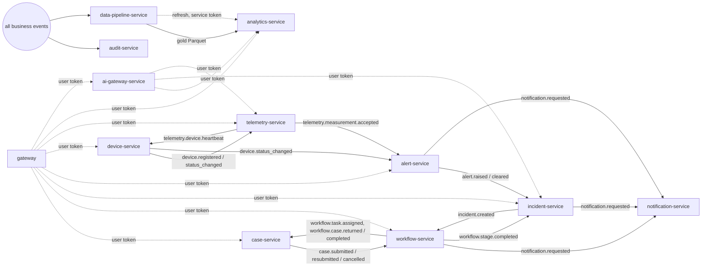

# Service map

## Responsibility matrix

Status: **Implemented** = code, migrations, API, authorization and tests exist and were run.
**Not started** = service boundary defined, no code. No service is partially implemented behind
placeholder responses.

| # | Service | Responsibility | Status | Runtime | Database | Publishes | Consumes |
| --- | --- | --- | --- | --- | --- | --- | --- |
| 1 | tenant-service | Organisations, departments, jurisdictions, tenant configuration, memberships | Implemented | NestJS | `titan_tenant` | `tenant.*` | — |
| 2 | case-service | Forms, case records, submissions, lifecycle, attachments, applicant tracking | Implemented | NestJS | `titan_case` | `case.*` | `workflow.task.assigned`, `workflow.case.*` |
| 3 | workflow-service | Versioned processes, tasks, decisions, delegations, SLAs, escalation | Implemented | NestJS | `titan_workflow` | `workflow.*`, `notification.requested` | `case.*`, `incident.created` |
| 4 | document-service | Attachments, versions, secure download, retention | **Not started** (attachments are stored by case-service, max 2 MB) | — | — | — | — |
| 5 | notification-service | In-app notifications, e-mail adapter, delivery status, retry | Implemented (log adapter; no real mail) | NestJS | `titan_notification` | `notification.delivered/failed` | `notification.requested` |
| 6 | audit-service | Append-only business and security records | Implemented | NestJS | `titan_audit` | — | all except telemetry |
| 7 | asset-service | Assets, categories, hierarchy, lifecycle, maintenance state | Implemented | NestJS | `titan_asset` | `asset.*` | — |
| 8 | maintenance-service | Work orders, inspections, schedules, technicians | **Not started** (asset-service holds condition and due dates) | — | — | — | — |
| 9 | procurement-service | Inventory, suppliers, requisitions, stock | **Not started** | — | — | — | — |
| 10 | incident-service | Incident lifecycle, severity, assignment, timeline | Implemented | NestJS | `titan_incident` | `incident.*`, `notification.requested` | `alert.*`, `workflow.task.assigned`, `workflow.stage.completed` |
| 11 | device-service | Device registry, sensors, status, configuration, offline detection | Implemented | NestJS | `titan_device` | `device.*` | `telemetry.device.heartbeat` |
| 12 | telemetry-service | MQTT ingestion, validation, time series | Implemented | NestJS | `titan_telemetry` | `telemetry.*` | `device.registered`, `device.status_changed` |
| 13 | alert-service | Threshold rules, alarms, deduplication, escalation, acknowledgment | Implemented | NestJS | `titan_alert` | `alert.*`, `notification.requested` | `telemetry.measurement.accepted`, `device.*` |
| 14 | geospatial-service | Spatial records, layers, geofences, digital twin | **Not started** (the map reads coordinates from assets and devices) | — | — | — | — |
| 15 | video-service | Cameras, stream sessions, recordings metadata | **Not started** | — | — | — | — |
| 16 | integration-service | Open-data adapters, external APIs, webhooks | **Not started** | — | — | — | — |
| 17 | data-pipeline-service | Ingestion, bronze/silver/gold, quality, lineage | Implemented | FastAPI | `titan_pipeline` + lake | `pipeline.run.completed` | business events (bronze) |
| 18 | analytics-service | KPI read models, analytical API, export, query templates | Implemented | FastAPI | `titan_analytics` | — | gold datasets |
| 19 | ai-gateway-service | Model access, retrieval, tools, proposals, drafts | Implemented | FastAPI | `titan_ai` | `ai.tool.executed` | — |
| 20 | report-service | Scheduled reports, templates, exportable documents | **Not started** (the AI gateway produces reviewable drafts; analytics exports datasets) | — | — | — | — |
| — | gateway | Edge authentication, rate limiting, routing, live stream, aggregated health | Implemented | NestJS | none | — | event stream (fan-out to browsers) |
| — | web | Command center | Implemented | static site | none | — | — |

## Dependency map

Solid arrows are asynchronous events (the publisher does not know or wait for the consumer).
Dashed arrows are synchronous HTTP calls.

### What depends on what at run time

| If this is down | Still works | Stops or is delayed |
| --- | --- | --- |
| notification-service | Approvals, incidents, alarms | Notifications are delivered after it returns (verified, Test G) |
| audit-service | Everything else | Audit records are written after it returns; none are lost (verified, Test G) |
| analytics / pipeline | All operational screens | KPI cards show "service unavailable" |
| ai-gateway / model | Everything else | AI workspace unavailable, or deterministic answers |
| incident-service | Alarms are still raised | Incidents are created when it returns (verified, Test D) |
| workflow-service | Case drafting, telemetry, alarms | Submitted cases wait; incidents cannot be acknowledged (acknowledgment is a workflow step) |
| NATS | All reads and writes (events buffer in each outbox) | Cross-service effects resume when it returns (verified, Test D) |
| Keycloak | Requests with a still-valid token (keys are cached) | New sign-ins |
| PostgreSQL | Nothing that needs data | Everything; see the DR runbooks |

There is no chain of synchronous calls between business services on a write path: a write
commits in one service and reaches the others as events.
