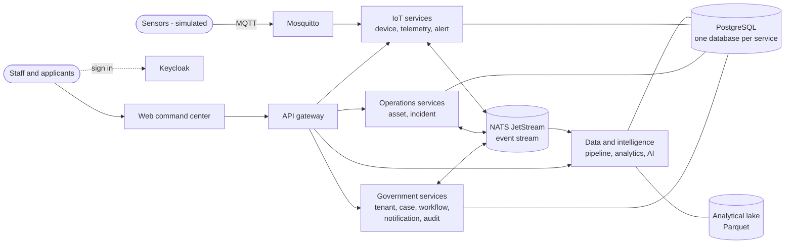

# System overview

TITAN (Total Intelligence, Technology, Automation & Network Platform) is a multi-tenant
operations platform for government and enterprise organisations. It combines case management
with multi-stage approvals, infrastructure asset records, IoT monitoring with alarms and
incidents, analytical reporting and an optional AI assistant.

**Status: development release.** Built and verified on one workstation with synthetic data.
Not production-certified, not government-approved, not proven highly available.

## What it does today

| Capability | What is implemented |
| --- | --- |
| Government workflows | Configurable forms; draft, submit, return, resubmit, cancel; versioned workflows with sequential, parallel and conditional stages; role-based tasks; delegation; SLA due dates and escalation; decision history; applicant notifications at configured milestones |
| Operations | Asset register with categories, hierarchy, lifecycle and maintenance state; incidents with timeline, assignment and a response workflow |
| IoT / flood monitoring | Device registry; MQTT ingestion with validation, quality flags and deduplication; monthly-partitioned time series; threshold rules with hysteresis; alarms; automatic incidents; offline detection; live dashboards. All sensor data is simulated |
| Data and analytics | Bronze / silver / gold pipeline (Polars, DuckDB, Parquet); run history, lineage, quality results; six KPI datasets; CSV and Parquet export; approved query templates |
| AI (optional) | Questions over authorised data through read-only tools; incident summaries; bottleneck explanation; document search; draft reports; human-approved proposals. Works without a model, labelled as deterministic |
| Platform | Keycloak sign-on; per-service databases with row-level security; transactional outbox and idempotent consumers on NATS JetStream; API gateway with rate limiting, circuit breakers and bulkheads; metrics, logs and alert rules |
| Recovery | Standby database with streaming replication; backup and verified restore; scripted failover and failback drills with measured results (single-host lab) |

## Shape of the system

- The **web application** is static files; it talks only to the gateway.
- The **gateway** authenticates, rate-limits and routes. It makes no business decisions.
- Each **service** owns its data and rules, verifies tokens itself, and communicates with other
  services through durable events (or, in a few read paths, their public APIs).
- **Keycloak** issues tokens that carry the user's tenant and roles.

## Design principles

1. **Independent services with private data.** No service reads another service's tables.
2. **Events for coordination.** State changes are published through a transactional outbox;
   consumers are idempotent because delivery is at-least-once.
3. **Tenant isolation in depth.** The tenant comes from the signed token; the database enforces
   it again with row-level security.
4. **Critical paths do not depend on optional ones.** Approvals and alarms work when analytics,
   notifications, audit or AI are down (tested).
5. **Honest status.** Simulated data is labelled; deterministic text is not presented as AI;
   recovery figures come only from executed drills.

## Service inventory

13 of the 20 planned business services are implemented, plus the gateway and web application.
See the [service map](service-map.md) for responsibilities and the [roadmap](../roadmap.md) for
the seven that are not started: document, maintenance, procurement, geospatial, video,
integration and report.

## Technology

| Layer | Technology |
| --- | --- |
| Web | Next.js 16 (static export), React 19, TypeScript, Tailwind CSS 4, TanStack Query, Apache ECharts, MapLibre GL, served by nginx |
| Node services | NestJS 12, TypeScript 6.0, Zod, `pg`, plain SQL migrations |
| Python services | FastAPI, psycopg 3, Polars, DuckDB |
| Identity | Keycloak 26 (OIDC, Authorization Code + PKCE) |
| Data | PostgreSQL 17 with pgvector; Parquet lake |
| Messaging | NATS 2.12 JetStream; Eclipse Mosquitto 2 (MQTT) |
| AI runtime | Ollama (optional) |
| Operations | Docker Compose profiles; Prometheus, Grafana, Loki, Alloy; Helm chart and manifests for Kubernetes (planned topology) |

Decisions and their reasons are recorded in the [ADRs](../adr/README.md).
