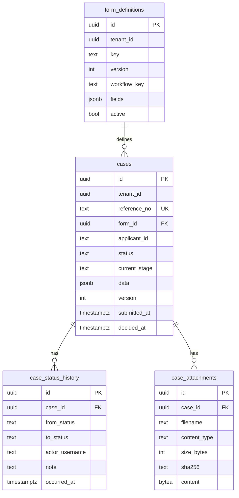
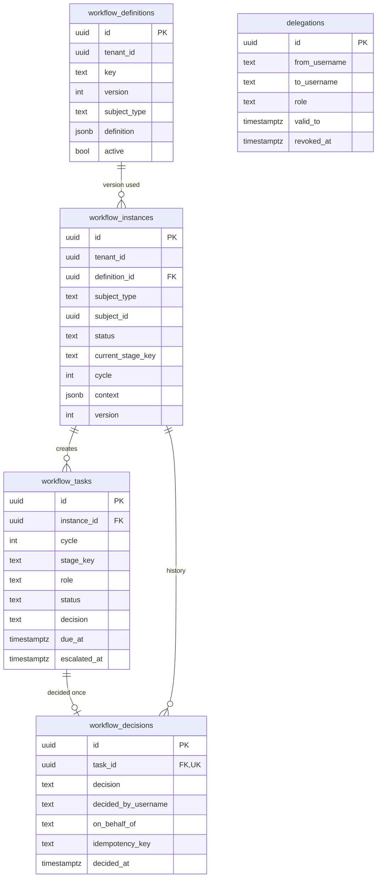
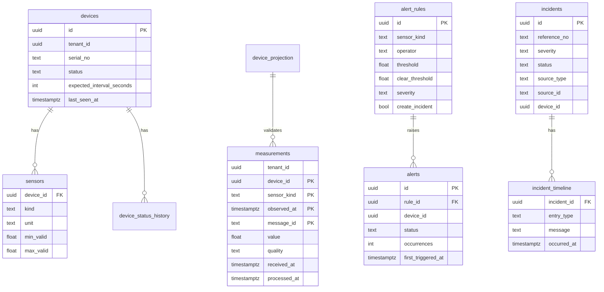
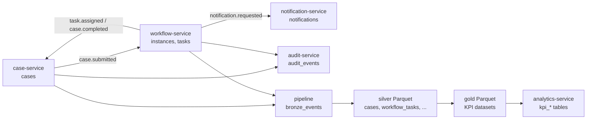

# Database design

PostgreSQL 17 is the operational database. Locally, all service databases live on one instance
to save memory; each is still a separate database with its own owner and runtime role, so
moving a service to its own instance is a connection-string change.

## Ownership matrix

| Database | Owning service | Migration role | Runtime role | Notable tables |
| --- | --- | --- | --- | --- |
| `titan_tenant` | tenant-service | `tenant_owner` | `tenant_app` | tenants, tenant_config, departments, jurisdictions, memberships |
| `titan_case` | case-service | `case_owner` | `case_app` | form_definitions, cases, case_status_history, case_attachments |
| `titan_workflow` | workflow-service | `workflow_owner` | `workflow_app` | workflow_definitions, workflow_instances, workflow_tasks, workflow_decisions, delegations |
| `titan_notification` | notification-service | `notification_owner` | `notification_app` | notifications, notification_reads |
| `titan_audit` | audit-service | `audit_owner` | `audit_app` | audit_events (append-only) |
| `titan_asset` | asset-service | `asset_owner` | `asset_app` | asset_categories, assets, asset_status_history |
| `titan_device` | device-service | `device_owner` | `device_app` | devices, sensors, device_status_history |
| `titan_telemetry` | telemetry-service | `telemetry_owner` | `telemetry_app` | measurements (partitioned), latest_measurements, device_projection, rejected_messages |
| `titan_alert` | alert-service | `alert_owner` | `alert_app` | alert_rules, alerts, device_names |
| `titan_incident` | incident-service | `incident_owner` | `incident_app` | incidents, incident_timeline |
| `titan_pipeline` | data-pipeline-service | `pipeline_owner` | `pipeline_app` | bronze_events, pipeline_runs, dataset_catalog, lineage_edges, quality_results |
| `titan_analytics` | analytics-service | `analytics_owner` | `analytics_app`, `analytics_ro` | kpi_* read models, dataset_loads |
| `titan_ai` | ai-gateway-service | `ai_owner` | `ai_app` | reference_documents, document_chunks (pgvector), tool_executions, pending_actions, report_drafts |
| `keycloak` | Keycloak | `keycloak` | `keycloak` | identity store |

Rules that make this ownership real:

- `REVOKE ALL ON DATABASE ... FROM PUBLIC`; a runtime role can connect only to its own database
  (tested: `asset_app` cannot connect to `titan_case`).
- The **owner** role runs migrations and owns the tables. The **runtime** role has only DML and is
  subject to row-level security. Neither is a superuser or has `BYPASSRLS`.
- Every Node service database also has the platform tables `outbox`, `inbox`, `dead_letters`.
- Data needed from another service is copied by events into a **local projection**
  (`device_projection` in telemetry, `device_names` in alerting), never joined across databases.

## Conventions

| Topic | Convention |
| --- | --- |
| Keys | UUID primary keys (`gen_random_uuid()`); human references such as `APP-2026-000012` are separate unique columns |
| Tenancy | Every tenant-scoped table has `tenant_id uuid NOT NULL` and an RLS policy `tenant_id = app_tenant_id()` |
| Time | `timestamptz`, UTC. `created_at`, `updated_at`; domain timestamps named for what happened (`submitted_at`, `decided_at`) |
| Concurrency | `version integer` incremented on every change; writers send `expected_version` and get `409 stale_version` if it moved |
| Master vs transactional | Definitions and catalogues (forms, workflow definitions, categories, rules) are versioned master data; cases, tasks, incidents, measurements are transactional and reference the exact definition version they used |
| History | Lifecycle changes are appended to `*_history` / timeline tables; decisions and audit events are immutable |
| Integrity | Foreign keys inside a database; logical ids (no FK) across databases |
| Migrations | `NNNN_name.sql`, one transaction each, recorded with a checksum in `schema_migrations`; an applied file can never be edited |

## Tenant isolation in the database

```sql
-- set by the service at the start of every transaction, from the VERIFIED token
SELECT set_config('app.tenant_id', '<tenant uuid>', true);

-- on every tenant table
ALTER TABLE cases ENABLE ROW LEVEL SECURITY;
CREATE POLICY cases_isolation ON cases
  USING (tenant_id = app_tenant_id()) WITH CHECK (tenant_id = app_tenant_id());
```

With no tenant set, `app_tenant_id()` is NULL and no row matches (fail closed). Background work
that must look across tenants (SLA sweep, offline detection, delivery queue) calls a narrow
`SECURITY DEFINER` function that returns ids only; each item is then processed in its own tenant
transaction. Proven by `tests/security/tenant-isolation.test.ts`, which connects as the runtime
role and tries to read, write, move rows and disable the policy.

## Entity-relationship diagrams

### case-service



### workflow-service



`UNIQUE (tenant_id, subject_type, subject_id)` gives one process per subject;
`UNIQUE (instance_id, cycle, stage_key, role)` prevents duplicate tasks;
`UNIQUE (task_id)` on decisions guarantees a task is decided at most once.

### IoT: device, telemetry, alert, incident (four databases)



Lines between boxes in different databases (e.g. `alerts.device_id`) are logical references
carried by events, not foreign keys.

## Indexing

| Index | Serves |
| --- | --- |
| `cases (tenant_id, status, created_at DESC)` | List and review screens filtered by status |
| `cases (tenant_id, applicant_id, created_at DESC)` | "My applications" |
| `workflow_tasks (tenant_id, role, assigned_at) WHERE status = 'pending'` | Review inbox (partial: only open work) |
| `workflow_tasks (due_at) WHERE pending AND not escalated` | SLA sweep |
| `measurements (tenant_id, device_id, sensor_kind, observed_at DESC)` | Charts and range queries, per partition |
| `alerts (...) UNIQUE WHERE status IN ('active','acknowledged')` | Deduplication: one open alarm per rule and device |
| `incidents (tenant_id, source_type, source_id) UNIQUE WHERE source_id IS NOT NULL` | Deduplication: one incident per alarm |
| `outbox (seq) WHERE published_at IS NULL` | Relay reads only unpublished rows |
| `audit_events (tenant_id, aggregate_id, occurred_at)`, `(tenant_id, correlation_id)` | Trace a record or an operation |
| `document_chunks USING gin (tsv)`, `USING hnsw (embedding vector_cosine_ops)` | Lexical and semantic retrieval |

Partial indexes are used wherever a query only ever needs a small, hot subset.

## Time series partitioning and retention

`measurements` is range-partitioned by month on `observed_at`
(`measurements_2026_11`, ...) with a default partition for out-of-range timestamps.
`ensure_measurement_partitions()` creates partitions ahead of time;
`drop_expired_measurement_partitions(retain_months)` drops whole months
(`TELEMETRY_RETENTION_MONTHS`, default 24). Both run daily in telemetry-service.

| Data | Retention (configurable) | Mechanism |
| --- | --- | --- |
| Measurements | 24 months | Drop monthly partitions |
| Published outbox rows | 24 hours | Relay housekeeping |
| Inbox rows | 14 days (longer than the stream's 7) | Relay housekeeping |
| Bronze events | 30 days after being folded into silver | Pipeline run |
| Event stream | 7 days (lab) | JetStream `max_age` |
| WAL archive | 3 days (lab only) | Archive script; production: backup tool policy |
| Audit events, decisions, case history | Not deleted | Retention must follow the deploying agency's records schedule |

Archival to cold storage is not implemented (roadmap).

## Event-to-data flow



## Sensitive data

- Passwords are held only by Keycloak. Services store subject ids and usernames.
- Database credentials are per role; in the lab they derive from one development secret.
- Attachment content is stored in the case database with a SHA-256; downloads are forced as
  attachments with `nosniff`.
- Logs redact authorization headers, passwords, tokens and secrets.
- Encryption at rest is a deployment concern (volume or database encryption) and is not
  configured in the local stack.

## Backup and recovery

See the [backup and restoration runbook](../runbooks/backup-and-restore.md).
