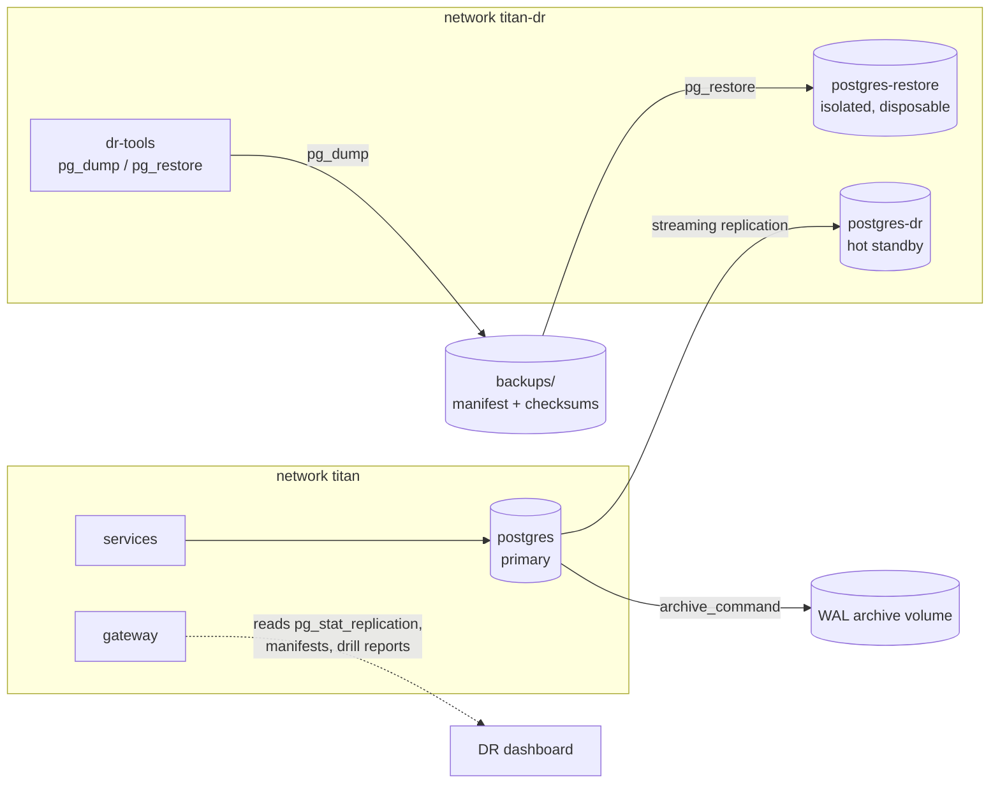

# Disaster recovery architecture

Two things are described here and kept apart:

1. **The DR lab (implemented).** A recovery database, backup tooling and scripted drills on one
   workstation. It proves the *procedure* and the software's behaviour during recovery.
2. **Regional DR (planned).** Two independent regions, active-passive. Designed; manifests are
   schema-validated; never deployed.

Two database containers on one laptop are **not** geographic disaster recovery, and nothing in
this repository describes them as such.

## Objectives

These are engineering **targets**. A target is not achieved until a test in the real
environment measures it.

| Tier | Services | RTO target | RPO target |
| --- | --- | --- | --- |
| 0 | Identity, tenant, case, workflow, incident, alert, device, telemetry ingestion | ≤ 60 min | ≤ 5 min |
| 1 | Assets, notifications, audit query | ≤ 4 h | ≤ 15 min |
| 2 | Analytics, data pipeline, AI | ≤ 24 h | ≤ 1 h (rebuildable) |

Observed values exist only for the lab and are in the
[verification report](../testing/verification-report.md#disaster-recovery-results) and the
generated reports under `infrastructure/disaster-recovery/reports/`. They were measured on one
host with a small synthetic dataset and say nothing about regional recovery times.

## Replication is not backup

| | Standby replication | Backup (base backup + WAL archive, or logical dump) |
| --- | --- | --- |
| Protects against | Loss of the primary server or site | Also: accidental deletion, logical corruption, a bad migration, ransomware |
| Why | Changes arrive in seconds | A replica faithfully replays the `DELETE`; a backup lets you go back to *before* it |
| Recovery point | Seconds (asynchronous) | Any point in time covered by the WAL archive (PITR), or the last dump |
| Requirement | — | Copies must be independent of the primary: other region, other account, versioned or immutable |

TITAN's design uses both. In the lab: a streaming standby **and** logical backups verified by
restore; WAL archiving is switched on (`archive_mode=on`) but point-in-time recovery has not
been drilled.

## What must be recovered, and how

| State | Lab (implemented) | Regional design (planned) |
| --- | --- | --- |
| PostgreSQL (all service databases) | Streaming standby `postgres-dr`; logical backup + verified restore | CloudNativePG replica cluster in the DR region fed from the WAL archive; base backups and WAL in versioned object storage; PITR |
| Keycloak identity state | Its database is in the same instance, so it is replicated and backed up with the rest; a new login after failover is part of the drill | Same database cluster; realm configuration also in Git |
| Event stream (NATS JetStream) | **Not replicated** (one broker). Unpublished events survive in each service's outbox, which is in the replicated database | 3-node cluster per region; DR region mirrors `TITAN_EVENTS`; after failover, consumers continue from the mirror, and the inbox absorbs any repeats |
| MQTT broker state | Not replicated | Devices reconnect to the DR broker endpoint; QoS 1 messages queued on the lost broker are lost (bounded by device buffering) |
| Object storage | None yet (attachments are in the case database) | Versioned buckets with cross-region replication when document-service exists |
| Kubernetes resources | n/a | Git + Argo CD (rebuild from the repository); Velero for cluster state |
| Application configuration | `.env.example`, compose file, realm generator: all in Git | Helm values per region in Git |
| Secrets and encryption keys | Development values only | Secret manager replicated to the DR region; never restored from backups; key-management service with multi-region keys |
| Audit records | Database, append-only; replicated and backed up | Same, plus export to immutable storage |
| Analytical datasets | Lake volume, **not backed up**; rebuildable from bronze / the stream | Object storage; rebuild procedure in the data-engineering document |
| AI knowledge sources | `titan_ai` database (documents, chunks, embeddings): replicated and backed up | Same; embeddings can be regenerated from document text |

## Lab topology (implemented)

- `postgres-dr` clones the primary with `pg_basebackup` on first start and streams from it.
- `postgres-restore` is reachable only on the `titan-dr` network and has disposable storage.
- The DR dashboard reads real state: roles and LSNs from both databases, replication from
  `pg_stat_replication`, stream state from JetStream, backups and drills from their files.

## Failover (active-passive, operator-confirmed)

Automatic failover between regions is deliberately **not** implemented. Without proven
fencing and quorum an automatic promotion risks a split brain, which is worse than an outage.

| # | Step | Lab script (`scripts/dr/failover-drill.mjs`) | Region |
| --- | --- | --- | --- |
| 1 | Detect primary failure | Primary unreachable from the tooling | Monitoring alerts, external probes |
| 2 | Confirm the scope | Standby reachable; which services are not ready | Is it the database, the region, or the network path? |
| 3 | Fence the primary | Stop the container, disable restart | Network isolation / scale to zero / revoke credentials. **Must be independent of the failed site** |
| 4 | Inspect replication progress | Received and replayed LSN, last replayed transaction time | Same, from the replica cluster |
| 5 | Identify the last recoverable state | Wait until everything received is replayed | Same; record the LSN |
| — | **Operator confirmation** | Typed `FAILOVER` or `--confirm-failover`; otherwise safe abort | Named decision-maker, recorded |
| 6 | Promote the DR database | `pg_promote()` | Set `replica.enabled: false` on the replica cluster (Git change) |
| 7 | Restore event processing | Outboxes drain; consumers resume | Consumers attach to the mirrored stream |
| 8 | Activate DR-side services | Recreate services with `DB_HOST=postgres-dr` | Scale up the standby workloads (Git change) |
| 9 | Validate | New login; recorded transactions; a new application approved end to end | Same, plus smoke tests |
| 10 | Redirect traffic | Not applicable (same gateway address) | DNS / global load balancer |
| 11 | Record measurements | Report with observed RTO and RPO | Same |
| 12 | Reconcile | Lost acknowledged writes; duplicates after replay; dead letters | Same, plus files and device data |
| 13 | Rebuild the old primary as a standby | `scripts/dr/failback.mjs` | Re-seed from the new primary |
| 14 | Controlled failback | Same script, planned outage, no data loss | Scheduled maintenance window |

**Safe abort.** If the operator does not confirm, the script restarts the original primary,
promotes nothing, and verifies the standby is still a standby.

## Application-level reconciliation

Asynchronous replication can lose the last moments before a failure. The platform is built so
that this is detectable and does not corrupt state:

- Business change and outbox row commit together: after failover either both exist or neither.
- Events published before the failure but whose effects were not replicated are redelivered or
  reprocessed; inbox and unique constraints prevent duplicates (checked in the drill).
- Events committed but not yet published are in the replicated outbox and are published by
  the relay on the recovery side.
- The drill counts acknowledged writes missing after failover; that count is the measured loss.

What is **not** reconciled automatically: effects in systems outside the database (an e-mail
already sent for a transaction that was lost; MQTT messages queued on a lost broker).

## Risks that remain

See the [risk register](../risk-register.md). The main ones: no regional environment exists; the
event stream and lake are not replicated in the lab; point-in-time recovery is untested;
fencing in the lab is a container stop.
