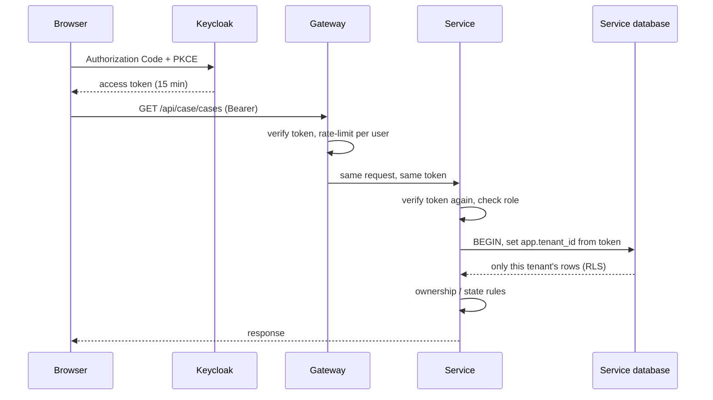

# Identity and authorization design

## Identity provider

Keycloak 26, realm `titan`, imported at start from
`infrastructure/docker/keycloak/titan-realm.json` (generated by `generate-realm.mjs`).

| Client | Type | Use |
| --- | --- | --- |
| `titan-web` | Public, Authorization Code + PKCE (S256) | The web command center |
| `titan-cli` | Public, password grant | **Development and tests only.** Lets scripts obtain tokens for demo users. Remove outside development |
| `svc-pipeline`, `svc-ai` | Confidential, client credentials | Machine identities of the data pipeline and the AI gateway |

Tokens carry:

| Claim | Source | Used for |
| --- | --- | --- |
| `sub`, `preferred_username`, `email` | Keycloak account | Who the caller is |
| `tenant_id` | User attribute, editable only by an administrator | Which tenant the caller belongs to |
| `department` | User attribute | Display and attribute rules |
| `realm_access.roles` | Realm roles | What the caller may do |
| `aud = titan-api` | Audience mapper | Tokens for other audiences are refused |

A user token without a well-formed `tenant_id` is rejected. A token holding the `service` role is
a machine identity: it is given the platform tenant id whatever it claims, so it sees no tenant
data and can only use endpoints that explicitly allow `service`.

Because the browser and the services reach Keycloak by different addresses, Keycloak is
configured with a fixed public issuer (`KC_HOSTNAME`), and services fetch keys from the internal
address (`OIDC_JWKS_URI`) while validating the public issuer (`OIDC_ISSUER`).

## Request flow

Centralised authentication, distributed authorization: only Keycloak authenticates; every
service decides for its own data.

## Roles (RBAC)

| Role | May |
| --- | --- |
| `applicant` | Create, edit, submit, cancel and track **their own** applications |
| `validation_officer`, `technical_officer`, `department_head`, `final_approver` | Read cases of their tenant; decide tasks assigned to their role |
| `duty_officer` | Acknowledge incidents and alarms; create and assign incidents; add notes |
| `incident_commander` | Resolve and close incidents; everything a duty officer may do on incidents |
| `iot_operator` | Register devices; manage alert rules; acknowledge alarms |
| `asset_manager` | Create and change assets, lifecycle and maintenance |
| `analyst` | Read KPIs; export datasets; run the pipeline; review report drafts |
| `auditor` | Read audit records, deliveries, AI tool log |
| `tenant_admin` | Tenant configuration, departments, memberships, forms, workflow definitions, reference documents |
| `dr_operator` | View DR status and operate recovery (from the command line) |
| `platform_admin` | Create and list tenants |
| `service` | Call internal endpoints (machine identities only) |

Staff roles can read operational screens of their own tenant (assets, devices, telemetry,
alarms, incidents, KPIs). The exact requirement of each route is in its controller and in the
generated [API specifications](../api/README.md).

## Attribute and state rules (ABAC)

Roles alone are not enough; these rules are evaluated against attributes of the caller and the record:

| Rule | Attributes | Enforced in |
| --- | --- | --- |
| Tenant isolation | `token.tenant_id` = `row.tenant_id` | Every service and the database (RLS) |
| An applicant sees only their own cases; other people's drafts are private | `token.sub` = `case.applicant_id`, `case.status` | case-service |
| Only the role a task is assigned to may decide it | `task.role` in `token.roles` | workflow-service |
| A delegate may decide for the delegated role, while the delegation is active | `delegation.to_username`, `role`, validity window, not revoked | workflow-service |
| Nobody decides on their own application | `instance.applicant_id` ≠ `token.sub` | workflow-service |
| A user can delegate only a role they hold | `role` in `token.roles` | workflow-service |
| A case is editable only as draft or returned; decided cases are final | `case.status` | case-service |
| A document restricted to roles is visible only to them | `document.allowed_roles` ∩ `token.roles` | ai-gateway-service (in SQL) |
| A proposal is executed with the approver's permissions | approver's token | ai-gateway-service → incident-service |

Records of another tenant or another owner answer **404**, not 403, so their existence is not disclosed.

## Service-to-service

| Call | Identity used | Why |
| --- | --- | --- |
| Gateway → any service | The user's token | The service must authorise the real caller |
| AI gateway → analytics / incident / telemetry | The user's token | The assistant can never see more than the person asking |
| Data pipeline → analytics `/internal/refresh` | `svc-pipeline` client credentials | No user is involved; the endpoint accepts only role `service` |
| Service → database | Its own runtime role | Database-per-service |
| Service → NATS | Unauthenticated in the lab | *Planned:* per-service NATS credentials and subject permissions |

## Multi-factor authentication

Keycloak's TOTP is configured in the realm and any account can enrol. It is **not enforced** in
the development realm, because automated tests sign in with a password. For a real deployment:
make "Configure OTP" a required action for `tenant_admin`, `platform_admin`, `dr_operator`,
`final_approver` and `auditor`, or use a conditional authentication flow keyed on those roles,
and remove the `titan-cli` client.

## Demo identities (synthetic, test-only)

Password for every demo user: the value of `DEMO_USER_PASSWORD` in `.env`.

| Tenant | Users |
| --- | --- |
| Riverbend City Council | `alice.applicant`, `aaron.applicant`, `victor.validator`, `tara.technical`, `henry.head`, `fiona.final`, `derek.duty`, `irene.commander`, `amy.assets`, `anna.analyst`, `oscar.auditor`, `adam.admin` |
| Northfield District Authority | `bob.applicant`, `vera.validator`, `tom.technical`, `hana.head`, `frank.final`, `dana.duty`, `brian.admin` |
| Platform | `pat.platform` (platform administrator and DR operator) |
