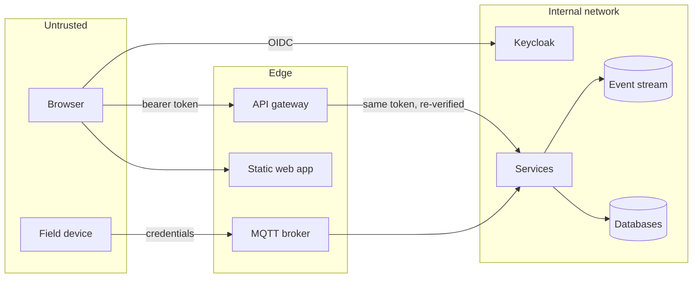

# Security architecture

Status: the controls below are implemented and tested in the local stack unless marked
*planned*. TITAN has **not** had an independent security review or penetration test and holds no
certification. OWASP ASVS was used as a checklist for what to verify, not as a claim of conformance.

## Trust boundaries

Nothing inside the internal network is trusted because of where it is: every service verifies
the token on every request and authorises against its own data.

## Controls

| Area | Control | Where | Verified by |
| --- | --- | --- | --- |
| Authentication | OIDC Authorization Code + PKCE for the web app; tokens kept in memory only | `apps/web/src/lib/auth.tsx` | Browser tests sign in through Keycloak |
| Token verification | Signature (RS/ES/PS256), issuer, audience `titan-api`, expiry; `alg=none`, tampered and foreign tokens rejected | `packages/authentication`, `packages/pykit` | Unit tests; `authorization.test.ts` |
| Authorization | Role required per route (`@RequireRoles`), plus ownership and state rules in the service | each service | Tests A, B, C, security suite |
| Tenant isolation | Tenant from the token only; PostgreSQL row-level security on every tenant table | `Db.tx`, migrations | Test C (API and database level) |
| Service identity | Client-credentials tokens with role `service`; internal endpoints accept only that role; a service identity belongs to no tenant | Keycloak realm, `/internal/refresh` | `analytics.test.ts` |
| Least privilege (database) | Per-service owner and runtime roles; no superuser, no `BYPASSRLS`; read-only role for query templates; append-only audit and decisions | init script, migrations | Test C, `analytics.test.ts` |
| Input validation | Zod / Pydantic schemas on every body and query; unknown form fields rejected; UUID path parameters checked | `ZBody`, `ZQuery`, FastAPI models | Unit and security tests |
| Injection | Parameterised SQL everywhere; `LIKE` wildcards escaped; no dynamic SQL from user input; AI may only run approved query templates | services | Security suite |
| File handling | Type allow-list, content signature check, 2 MB limit, sanitised names, forced download, `nosniff` | `case-service/src/forms.ts` | Unit and security tests |
| Rate limiting | Token bucket per user at the gateway (`RATE_LIMIT_PER_MINUTE`); AI requests limited per user | `apps/gateway/src/rate-limit.ts` | Unit test; performance smoke (live) |
| Overload protection | Per-service timeout, circuit breaker and concurrency bulkhead at the gateway | `apps/gateway/src/proxy.ts` | Unit tests; Test G; performance smoke |
| Duplicate / concurrent actions | Row locks per process, unique decision per task, idempotency keys | `workflow-service` | Security suite (10 simultaneous decisions) |
| Audit | Every business event and every denied access recorded; append-only at the database | `audit-service` | Tests A, C |
| Traceability | Correlation id and trace id on every request, log line and event | `packages/observability` | Audit assertions |
| Secrets | `.env` is git-ignored; realm import and broker credentials are filled from the environment; no secret in an image | compose, Keycloak, Mosquitto entrypoints | Review |
| Transport headers | CSP, `X-Frame-Options: DENY`, `nosniff`, referrer policy on the web app; CORS restricted to the web origin | nginx template, gateway | Manual check of headers |
| Containers | Non-root users, read-only root filesystem, `no-new-privileges`, memory limits; host ports bound to 127.0.0.1 | compose, Dockerfiles | Stack runs with these settings |
| Operational endpoints | `/metrics` and `/health` of services are not routed by the gateway | `proxy.ts` | Security suite |
| Error handling | Uniform error body with a correlation id; no stack traces or SQL in responses | `ProblemFilter` | Security suite |
| Dependencies | `npm audit` on runtime dependencies: 0 known vulnerabilities at the time of verification; audit jobs defined in CI | CI workflow | Executed locally |
| AI | Read-only tools, user's own token, schema-validated arguments, injection screening, human approval for writes, audit of every tool call | `ai-gateway-service` | Test E |
| Physical safety | No actuation of equipment exists anywhere in the platform | — | By construction |

## Threats considered

| Threat | Mitigation | Residual risk |
| --- | --- | --- |
| A user changes the tenant in a request | Tenant is read only from the signed token; body and header values are ignored | None known |
| A bug forgets a tenant filter | Row-level security returns no rows without the tenant bound | A service that deliberately sets another tenant would defeat it; code review |
| Stolen access token | 15-minute lifetime; HTTPS in production (*planned*); no refresh token in browser storage | Token valid until expiry; no revocation check per request |
| Reviewer approves their own application | Separation-of-duties rule in the decision transaction | — |
| Two reviewers decide at once / double click | Instance row lock + unique decision + idempotency key | — |
| Replayed or duplicated events | Broker dedup window, inbox, unique constraints | — |
| Malicious upload | Allow-list + signature check + forced download | No antivirus scan (roadmap) |
| Prompt injection through documents or records | Flagged content is never sent to a model; the model has no write tool; user token scopes every read | Pattern screening is heuristic; safety rests on the structural limits |
| Spoofed device telemetry | Broker credentials and ACL; device must be registered under the tenant in the topic | One shared simulator credential in the lab; per-device credentials are *planned* |
| Compromised service | Own database only, least-privilege role, network policies (*planned*, in the Helm chart) | Shared event stream is readable by every service |
| Insider with database access | Audit and decisions are append-only for runtime roles; trigger blocks changes even by the owner | A superuser can drop the trigger; needs database audit logging |

## Known gaps (see the [risk register](../risk-register.md))

- No TLS in the local stack; ingress TLS and broker TLS are in the planned Kubernetes topology.
- No mutual TLS between services; service-to-service calls rely on bearer tokens.
- MFA is available in Keycloak but not enforced for privileged demo accounts.
- The static web app needs `'unsafe-inline'` in its CSP for scripts and styles.
- The map page's background tiles come from the public OpenStreetMap server by default: the
  viewer's browser contacts that third party (IP address and viewed area, no platform records).
  `MAP_TILE_URL` points it elsewhere or, with `none`, switches it off. It is the only request the
  web application makes outside the platform, and the only external origin its CSP allows.
- Rate-limit and AI-limit state is per process, not shared between replicas.
- No web application firewall, antivirus scanning, or secret rotation automation.
- Data classification handling (retention, residency, encryption at rest) must be defined by the
  deploying agency; the platform makes no legal-compliance claim.
